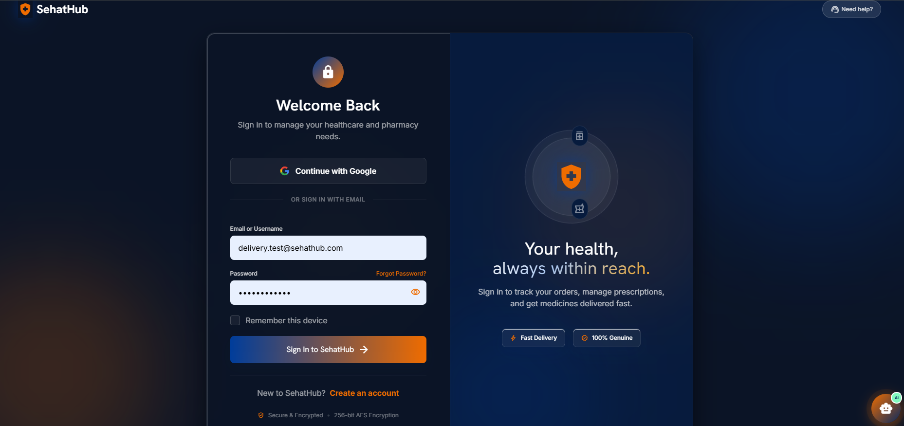
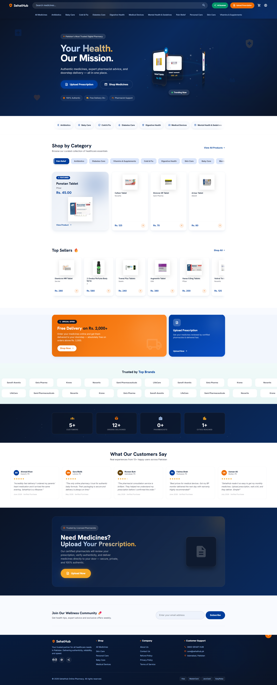
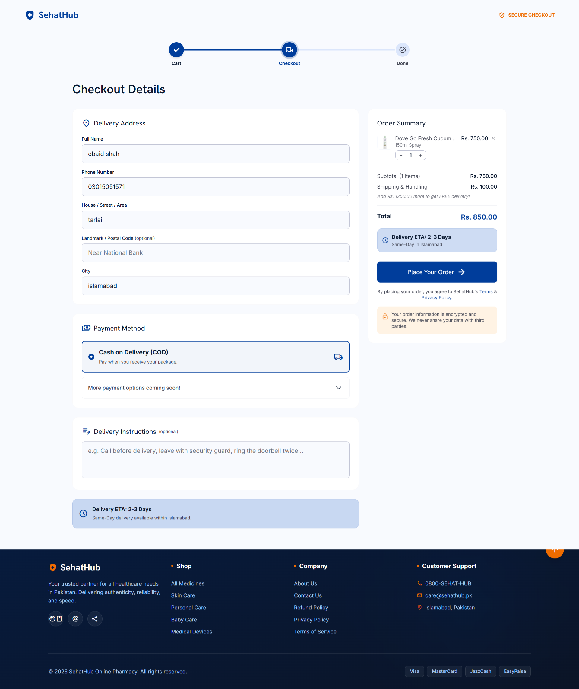
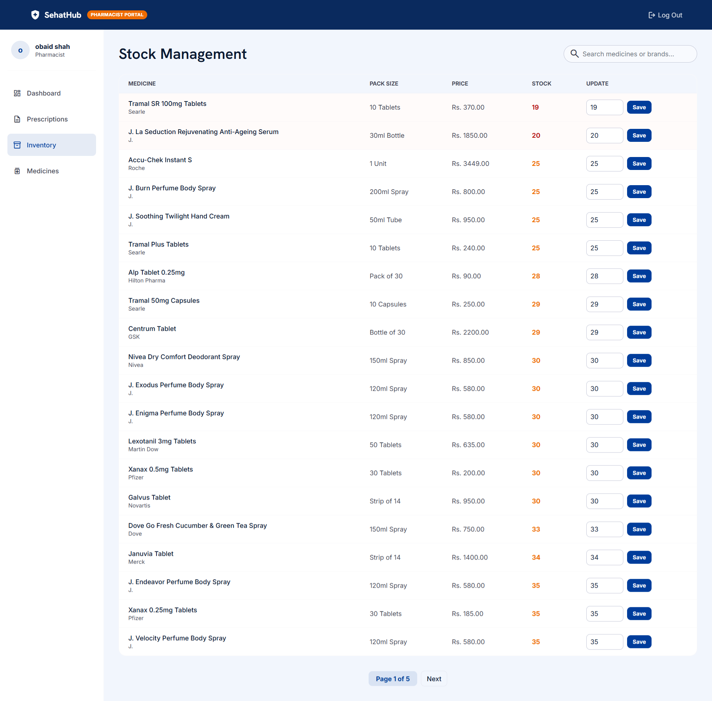
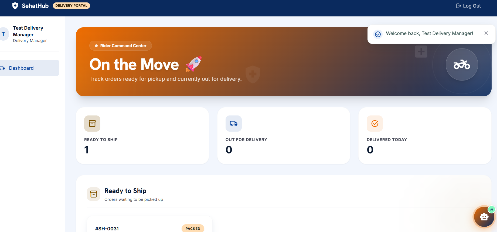
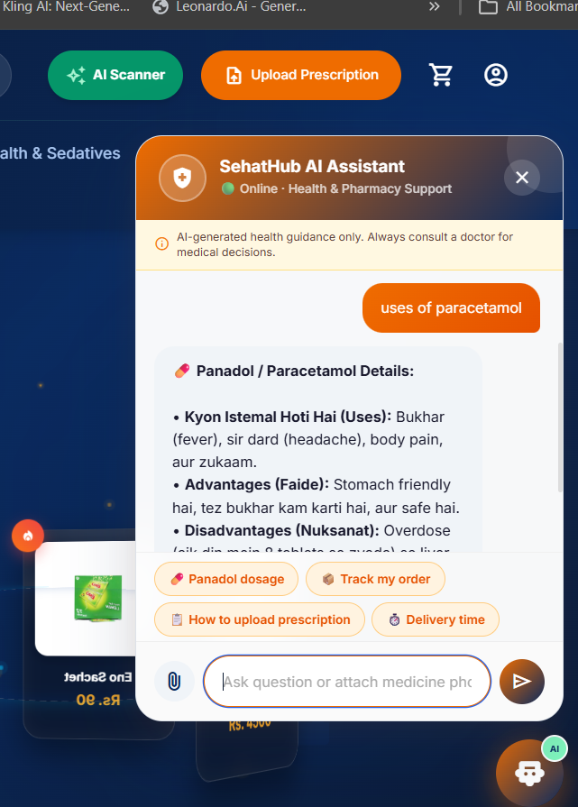

# SehatHub Project Documentation

**Course:** Database Management Systems (DBMS), 4th Semester  
**Project Type:** Semester Project, Full-Stack Web Application  
**Primary Author / Contributor:** Syed Obaid Ali (Roll No: 9321)  
**Project Repository:** [github.com/obaids093-prog/SehatHub-Pharmacy](https://github.com/obaids093-prog/SehatHub-Pharmacy)

---

## Table of Contents

1. [Introduction](#1-introduction)
   - [Problem Statement](#11-problem-statement)
   - [Proposed Solution](#12-proposed-solution)
2. [Project Objectives](#2-project-objectives)
3. [System Architecture & User Roles](#3-system-architecture--user-roles)
   - [3-Tier Architecture](#31-3-tier-architecture)
   - [User Roles & Responsibilities](#32-user-roles--responsibilities)
4. [Database Design](#4-database-design)
   - [Core Entities](#41-core-entities)
   - [Entity-Relationship Diagram](#42-entity-relationship-diagram)
   - [Normalization & ACID Compliance](#43-normalization--acid-compliance)
5. [Key Features](#5-key-features)
   - [Authentication & Account Management](#51-authentication--account-management)
   - [Customer Experience](#52-customer-experience)
   - [Pharmacist Operations](#53-pharmacist-operations)
   - [Admin Oversight & Sales Analytics](#54-admin-oversight--sales-analytics)
   - [Delivery Management](#55-delivery-management)
   - [AI Prescription Scanning & Health Assistant](#56-ai-prescription-scanning--health-assistant)
6. [Security Implementation](#6-security-implementation)
7. [Technology Stack](#7-technology-stack)
8. [Sample Database Queries](#8-sample-database-queries)
   - [Order Details (INNER JOIN)](#81-fetching-complete-order-details-inner-join)
   - [Low-Stock Report (LEFT JOIN + GROUP BY)](#82-low-stock-report-left-join--group-by)
   - [Unlinked Prescriptions (RIGHT JOIN)](#83-finding-unlinked-prescriptions-right-join)
   - [Full Customer Engagement Report (FULL OUTER JOIN Emulation)](#84-full-customer-engagement-report-full-outer-join-emulation)
9. [Future Technical Roadmap](#9-future-technical-roadmap)

---

## 1. Introduction

### 1.1 Problem Statement
Pharmacies in Pakistan frequently rely on manual, paper-based records to manage daily inventory, customer orders, and doctor prescriptions. This workflow creates operational bottlenecks:
- Customers must visit multiple pharmacies in person to locate specific or scarce medications.
- Paper prescriptions are prone to misplacement, physical damage, and handwriting misinterpretation.
- Dispatched orders lack status tracking between the counter and customer delivery.
- Low-stock events often go unnoticed until a counter transaction fails.

### 1.2 Proposed Solution
SehatHub is an online pharmacy platform built on a relational MySQL database and a modular Flask backend. The system covers medicine browsing, prescription uploads, verification, inventory control, and live order tracking. Four role-specific workflows (Customer, Pharmacist, Admin, Delivery Manager) ensure users interact only with the features and data appropriate to their operational responsibilities.

---

## 2. Project Objectives

1. **Digitize Records:** Move pharmacy stock, pricing, and order histories from paper ledgers to a normalized relational database.
2. **Prescription Verification:** Enforce a pharmacist approval step for restricted medicines before order dispatch.
3. **Role-Based Security:** Restrict routes, session cookies, and database operations according to authenticated user roles.
4. **Inventory Control:** Provide pharmacists and administrators with real-time stock updates, low-stock warnings, and categorization tools.
5. **Order Lifecycle Tracking:** Provide step-by-step order timelines from checkout to final delivery.

---

## 3. System Architecture & User Roles

### 3.1 3-Tier Architecture
SehatHub uses a 3-tier architecture that separates presentation, application logic, and data storage. The client browser communicates strictly with Flask endpoints via HTTP/HTTPS. Direct database queries from the frontend are prohibited.

```
+-------------------------------------------------------+
|                 Presentation Layer                    |
|      HTML5, Tailwind CSS, JavaScript, Jinja2          |
+---------------------------+---------------------------+
                            | HTTP / JSON Requests
                            v
+-------------------------------------------------------+
|               Business Logic Layer (Flask)            |
|   app.py, routes/ (auth, customer, pharmacist,        |
|   admin, delivery), utils/ (csrf, rate_limit, rbac)   |
+---------------------------+---------------------------+
                            | Parameterized SQL Queries
                            v
+-------------------------------------------------------+
|                   Data Layer (MySQL)                  |
|       InnoDB Engine, ACID Transactions, 16+ Tables    |
+-------------------------------------------------------+
```

### 3.2 User Roles & Responsibilities

| Role | Access Level | Primary Responsibilities |
|---|---|---|
| **Customer** | Frontend portal | Search catalog, upload prescriptions, manage cart, place COD orders, track deliveries, submit reviews. |
| **Pharmacist** | Operations dashboard | Review uploaded prescriptions, approve/reject orders, monitor stock levels, manage medicine inventory. |
| **Admin** | Management console | Review sales metrics (Chart.js), manage user status (activate/deactivate), audit medicine catalog and categories. |
| **Delivery Manager** | Dispatch console | Inspect assigned orders by delivery zone and update transit statuses (Out for Delivery, Delivered). |

---

## 4. Database Design

### 4.1 Core Entities

| Table | Purpose | Key Relationships |
|---|---|---|
| `users` | Base authentication credentials and roles | `1:1` with role-specific tables |
| `customers` | Customer profile attributes | Foreign key: `user_id` |
| `pharmacists` | Pharmacist profile attributes | Foreign key: `user_id` |
| `admins` | Administrator profile attributes | Foreign key: `user_id` |
| `delivery_managers` | Delivery personnel attributes | Foreign key: `user_id` |
| `medicines` | Catalog entries: brand, dosage, stock, pricing, prescription requirement | Foreign keys: `category_id`, `brand_id` |
| `medicine_categories` | Medicine classifications (e.g., Antibiotics, Analgesics) | `1:N` with `medicines` |
| `brands` | Pharmaceutical manufacturer records | `1:N` with `medicines` |
| `cart_items` | Active shopping cart items per customer | Foreign keys: `customer_id`, `medicine_id` |
| `orders` | Placed customer orders and financial totals | Foreign keys: `customer_id`, `delivery_manager_id` |
| `order_items` | Individual line items and purchase prices | Foreign keys: `order_id`, `medicine_id` |
| `prescriptions` | Uploaded prescription images and approval statuses | Foreign keys: `customer_id`, `order_id`, `reviewed_by` |
| `reviews` | Customer ratings (1-5 stars) and feedback | Foreign keys: `customer_id`, `medicine_id` |
| `delivery_zones` | Geographic delivery jurisdictions | `1:N` with assigned orders |

### 4.2 Entity-Relationship Diagram

The schema contains 16+ normalized tables with enforced foreign-key constraints and cascade rules.


### 4.3 Normalization & ACID Compliance

- **Normalization (3NF):** The database design adheres to Third Normal Form (3NF). Repeating groups are eliminated (1NF), all non-key columns depend on the primary key (2NF), and transitive dependencies are removed by isolating categories, brands, and roles into lookup tables (3NF).
- **ACID Compliance:** The database runs on the MySQL `InnoDB` storage engine. Transactions during checkout guarantee atomicity: stock quantity decrements and order record insertions commit together or roll back completely if an error occurs.

---

## 5. Key Features

### 5.1 Authentication & Account Management
- Role-specific signup and login paths for Customers, Pharmacists, Admins, and Delivery Managers.
- Passwords hashed with `bcrypt` before storage.
- Rate limiting on authentication routes to mitigate brute-force attacks.
- Session cookies configured with `HttpOnly`, `SameSite=Lax`, and optional `Secure` flags.



### 5.2 Customer Experience
- Catalog with real-time text search and filters by category, brand, and price.
- Shopping cart with quantity modification and stock validation.
- Checkout workflow supporting Cash on Delivery (COD).
- Live order tracking timeline: `Placed` -> `Confirmed` -> `Packed` -> `Shipped` -> `Delivered`.




### 5.3 Pharmacist Operations
- Prescription verification queue to review uploaded images and approve or reject submissions.
- Inventory oversight with stock level updates, reorder indicators, and low-stock warnings.




### 5.4 Admin Oversight & Sales Analytics
- Analytics dashboards powered by Chart.js displaying revenue trends and top-performing medicines.
- User management interface to inspect accounts, activate, or deactivate platform access.
- Audit logs tracking sensitive operational changes.


### 5.5 Delivery Management
- Dedicated portal displaying dispatch assignments filtered by zone.
- Single-action transit status transitions (`Out for Delivery`, `Delivered`) synchronized with customer tracking.



### 5.6 AI Prescription Scanning & Health Assistant
- **Prescription Vision Scanner:** Utilizes vision models via the Groq Cloud API to detect doctor notes, medicine names, dosages, and patient instructions directly from uploaded prescription images. Automatically flags non-medical uploads.
- **Health Assistant Chatbot:** Clinical information assistant bounded strictly to medicine queries, dosage guidelines, precautions, and platform help. Rejects queries outside healthcare domains and flags controlled substances.




---

## 6. Security Implementation

SehatHub integrates controls aligned with standard web application security requirements:

| Risk Category | Implemented Defense | Implementation Location |
|---|---|---|
| **SQL Injection** | Parameterized queries using `%s` placeholders exclusively | `routes/*.py`, `config/database.py` |
| **Cross-Site Scripting (XSS)** | Auto-escaping enabled across all Jinja2 HTML rendering | `templates/**/*.html` |
| **Cross-Site Request Forgery (CSRF)** | Synchronizer token generated per session and validated on state-changing POST requests | `utils/csrf.py`, `app.py` |
| **Credential Theft** | Password hashing with Bcrypt; plaintext passwords are never stored | `routes/auth.py` |
| **Privilege Escalation** | Route decorators validating session role on every request | `utils/auth_helpers.py` |
| **Brute-Force Attacks** | In-memory IP/account rate limiter with lockout periods | `utils/rate_limit.py` |
| **Session Hijacking** | Server-side sessions with `HttpOnly` and `SameSite` flags | `app.py` |

---

## 7. Technology Stack

- **Presentation:** HTML5, Tailwind CSS, JavaScript (ES6+), Chart.js
- **Backend Application:** Python 3.10+, Flask (Blueprints architecture)
- **Database Engine:** MySQL 8.0+ / MariaDB via XAMPP (InnoDB storage engine)
- **Database Driver:** `mysql-connector-python`
- **Security & Utilities:** `bcrypt`, custom CSRF validator, session-based rate limiter
- **AI Integrations:** Groq Cloud API (Vision & Llama NLP models)

---

## 8. Sample Database Queries

### 8.1 Fetching Complete Order Details (INNER JOIN)
Builds customer order receipts by joining `orders`, `users`, `order_items`, and `medicines`:

```sql
SELECT 
    o.order_id, 
    u.full_name AS customer_name,
    m.name AS medicine_name, 
    oi.quantity, 
    oi.price
FROM orders o
JOIN users u ON o.customer_id = u.user_id
JOIN order_items oi ON o.order_id = oi.order_id
JOIN medicines m ON oi.medicine_id = m.medicine_id
WHERE o.order_id = 1001;
```

### 8.2 Low-Stock Report (LEFT JOIN + GROUP BY)
Calculates total medicines grouped by category for the pharmacist inventory dashboard:

```sql
SELECT 
    c.name AS category_name,
    COUNT(m.medicine_id) AS total_medicines
FROM medicine_categories c
LEFT JOIN medicines m ON c.category_id = m.category_id
GROUP BY c.category_id
ORDER BY total_medicines DESC;
```

### 8.3 Finding Unlinked Prescriptions (RIGHT JOIN)
Identifies uploaded prescriptions not yet linked to an active order:

```sql
SELECT 
    p.prescription_id, 
    p.status, 
    o.order_id
FROM orders o
RIGHT JOIN prescriptions p ON o.order_id = p.order_id
WHERE o.order_id IS NULL;
```

### 8.4 Full Customer Engagement Report (FULL OUTER JOIN Emulation)
Lists all registered customers alongside orders, including accounts with no order history. Emulates FULL OUTER JOIN in MySQL using `UNION` of `LEFT JOIN` and `RIGHT JOIN`:

```sql
SELECT 
    u.user_id, 
    u.full_name, 
    o.order_id, 
    o.status
FROM users u
LEFT JOIN orders o ON u.user_id = o.customer_id
WHERE u.role = 'Customer'
UNION
SELECT 
    u.user_id, 
    u.full_name, 
    o.order_id, 
    o.status
FROM users u
RIGHT JOIN orders o ON u.user_id = o.customer_id
WHERE u.role = 'Customer';
```

---

## 9. Future Technical Roadmap

1. **Digital Payment Gateway Integration:** Add JazzCash, EasyPaisa, and card processing endpoints alongside the existing Cash on Delivery (COD) workflow.
2. **Automated Notification Dispatcher:** Connect order status transitions directly to webhook or SMS services to alert customers when orders ship.
3. **Prescription-to-Cart Pipeline:** Parse medicine names identified by Groq Vision directly against the `medicines` table to pre-populate customer carts upon pharmacist approval.

