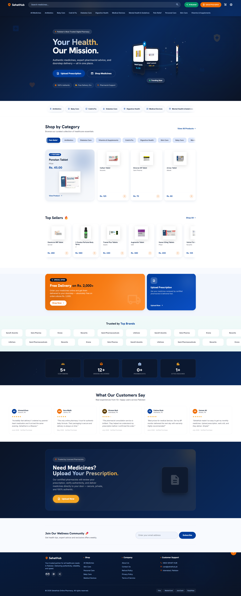

# SehatHub — Online Pharmacy Management System

SehatHub is a full-stack online pharmacy platform built as a DBMS semester project, modeled after real-world pharmaceutical services like Dawaai.pk and D.Watson. It covers the complete pharmacy workflow — from medicine catalog browsing, AI and pharmacist prescription verification, and cash-on-delivery ordering, to real-time inventory oversight and order dispatch tracking — across four dedicated user roles.

The application uses a 3-tier architecture with Python Flask, MySQL, and Tailwind CSS. It isolates database queries to the backend, enforces role-based access control across all routes, and uses Groq Vision to parse uploaded medical prescriptions.

[](https://www.python.org/)
[](https://flask.palletsprojects.com/)
[](https://www.mysql.com/)
[](https://tailwindcss.com/)
[](https://groq.com/)

---

## Visual Preview

| Customer Catalog & Cart | Pharmacist Operations |
|---|---|
|  |  |

| Admin Sales Analytics | AI Prescription Scanner |
|---|---|
|  |  |

---

## Role Features

### Customer
- **Medicine Catalog:** Filter by category, brand, and price, with instant search.
- **Cart & Ordering:** Quantity adjustments, stock checks, and Cash on Delivery (COD) checkout.
- **Prescription Upload:** Upload doctor slips for pharmacist validation before order dispatch.
- **Order Tracking:** Five-stage timeline from `Placed` to `Delivered`.
- **Customer Reviews:** Star ratings and text feedback per medicine.
- **AI Health Assistant:** In-app clinical chatbot for dosage details, side effects, and precautions.

### Pharmacist
- **Prescription Queue:** Review prescription images with approve/reject actions.
- **Inventory Oversight:** Stock counters with low-stock warnings and category organization.
- **Fulfillment Panel:** Move confirmed orders into dispatch readiness.

### Admin
- **Sales Analytics:** Revenue trends, volume metrics, and top-selling products visualized with Chart.js.
- **User Governance:** Inspect registered accounts and toggle account status.
- **Catalog Management:** Add, edit, or archive medicines, brands, and categories.
- **Audit Logs:** Monitor sensitive administrative actions.

### Delivery Manager
- **Zone Dispatch:** Filter orders by assigned delivery territories.
- **Transit Updates:** Advance orders to `Out for Delivery` and `Delivered`.

---

## AI Utilities

1. **AI Prescription Scanner (`utils/ai_prescription.py`):** Uses Groq Cloud Vision models to extract medicine names, dosages, and instructions from uploaded images, while rejecting non-medical photos.
2. **AI Health Assistant (`utils/ai_chatbot.py`):** Uses Llama models via Groq to provide short, structured answers on medicine usages, contraindications, and platform navigation.

---

## Security Architecture

- **SQL Injection Defense:** All database queries in `routes/` use parameterized `%s` placeholders via `mysql-connector-python`.
- **Cross-Site Scripting (XSS):** Jinja2 template auto-escaping enabled on all output paths.
- **Cross-Site Request Forgery (CSRF):** Synchronizer tokens validated on state-changing POST requests via `utils/csrf.py`.
- **Password Security:** Salted Bcrypt hashes stored in MySQL; plain-text passwords are never saved.
- **Access Control:** Role decorators (`@customer_required`, `@pharmacist_required`, `@admin_required`, `@delivery_required`) guard each route.
- **Brute-Force Rate Limiting:** Login throttling and lockout windows via `utils/rate_limit.py`.
- **Session Protection:** Configured with `HttpOnly`, `SameSite=Lax`, and configurable `Secure` flags.

---

## Architecture

SehatHub implements a 3-tier separation where client browsers interact exclusively with Flask application routes, and Flask manages all database transactions.

```
Presentation (HTML, Tailwind CSS, JS, Jinja2)
                      │
                      ▼
Application Logic (Python Flask Blueprints)
                      │
                      ▼
Data Persistence (MySQL / InnoDB Engine)
```

---

## Database Design

The schema contains 16+ normalized tables (Third Normal Form) with foreign-key constraints and ACID transaction handling during checkout.


Complete query examples (INNER JOIN, LEFT JOIN, RIGHT JOIN, and simulated FULL OUTER JOIN) are documented in [PROJECT_DOCUMENTATION.md](PROJECT_DOCUMENTATION.md).

---

## Project Structure

```
sehathub/
├── app.py                      # Flask application entry point & context processors
├── requirements.txt            # Python dependencies
├── sehathub_db.sql             # Complete database schema and seed data
├── ER diagram.png              # Entity-Relationship diagram
├── PROJECT_DOCUMENTATION.md    # Full academic and technical specification
├── .env.example                # Template for environment variables
├── config/
│   └── database.py             # MySQL connection pool handler
├── routes/
│   ├── auth.py                 # Signup, login, password reset
│   ├── customer.py             # Catalog browsing, cart, checkout, tracking
│   ├── pharmacist.py           # Stock management and prescription verification
│   ├── admin.py                # Sales analytics and user administration
│   └── delivery.py             # Delivery status dispatching
├── utils/
│   ├── ai_prescription.py      # Groq Vision prescription extraction
│   ├── ai_chatbot.py           # Groq NLP health assistant
│   ├── auth_helpers.py         # Role-based route decorators
│   ├── csrf.py                 # CSRF generation and verification
│   ├── rate_limit.py           # Login attempt throttling
│   └── validators.py           # Input validation helpers
├── templates/                  # Jinja2 HTML templates organized by role
├── static/                     # CSS, JavaScript, and UI assets
├── images/                     # Interface screenshots
└── uploads/prescriptions/      # Secure storage for uploaded prescriptions
```

---

## Getting Started

### Prerequisites
- Python 3.10 or higher
- MySQL Server 8.0+ or MariaDB (e.g., via XAMPP)
- Optional: Groq Cloud API key for AI features

### Setup Instructions

1. **Clone the repository:**
   ```bash
   git clone https://github.com/obaids093-prog/SehatHub-Pharmacy.git
   cd SehatHub-Pharmacy
   ```

2. **Create and activate a virtual environment:**
   ```bash
   python -m venv venv
   # Windows:
   venv\Scripts\activate
   # Linux/macOS:
   source venv/bin/activate
   ```

3. **Install dependencies:**
   ```bash
   pip install -r requirements.txt
   ```

4. **Configure environment variables:**
   ```bash
   # Copy the example environment file
   copy .env.example .env     # Windows
   cp .env.example .env       # Linux/macOS
   ```
   Open `.env` and set your database credentials and secret key:
   ```env
   SECRET_KEY=your-random-secret-key
   DB_HOST=localhost
   DB_USER=root
   DB_PASSWORD=
   DB_NAME=sehathub_db
   GROQ_API_KEY=your_groq_api_key_optional
   ```

5. **Import the database schema:**
   - Start MySQL (e.g., in XAMPP control panel).
   - Create a database named `sehathub_db`.
   - Import `sehathub_db.sql` via phpMyAdmin or the MySQL CLI:
     ```bash
     mysql -u root -p sehathub_db < sehathub_db.sql
     ```

6. **Run the application:**
   ```bash
   python app.py
   ```
   Access the web interface at `http://127.0.0.1:5000`.

---

## Contributor

| Name | Roll No. | Role |
|---|---|---|
| **Syed Obaid Ali** | 9321 | Full-Stack Development & Database Architecture |

---

*Academic Project — Database Management Systems (DBMS)*
